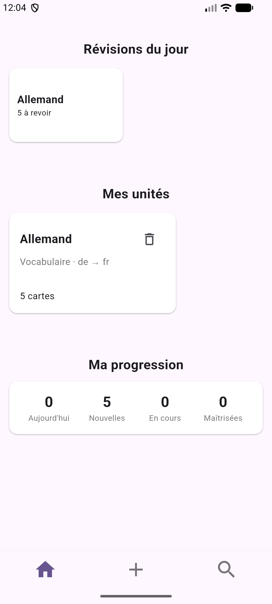
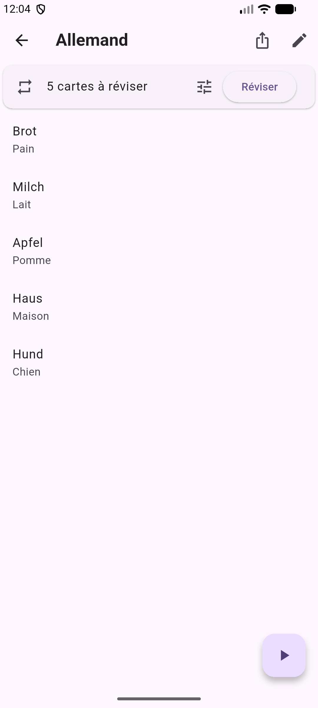
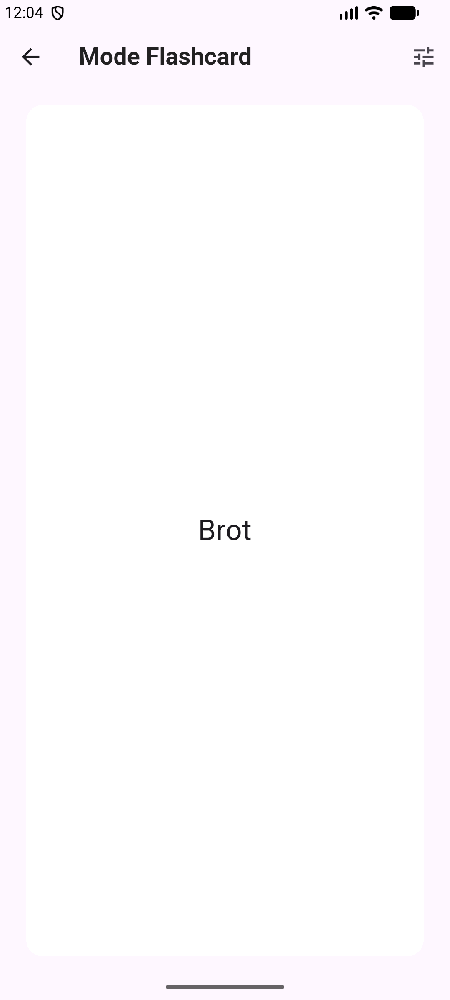
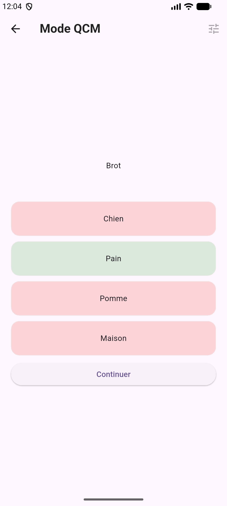

<p align="center">
  
</p>

# MemCards

*Une application de flashcards multiplateforme en Dart/Flutter*

Travail de maturité, 2026.

MemCards est une application gratuite pour créer ses propres cartes et les étudier, pensée pour les élèves du canton de Genève.

> Cette version ne contient pas d'OCR, car elle est destinée à F-Droid. La version avec OCR reste disponible dans [v1.0.0](../../releases/tag/v1.0.0).

## Fonctionnalités

- Créer, modifier et supprimer des *decks*, et réutiliser une carte dans plusieurs decks
- Trois types de deck : vocabulaire (avec une langue par côté), définitions et réponses courtes
- Trois modes d'entraînement : flashcard (avec swipe), écrit et QCM
- Options : inverser terme et définition, mélanger, pièges d'orthographe (QCM)
- Reprise de la session là où on s'était arrêté
- Révision espacée basée sur l'algorithme SM-2, avec une limite quotidienne par deck
- Partage de decks par fichier JSON (export et import)

<p align="center">




</p>

## Installation

**Android** : un APK est disponible dans les [Releases](../../releases/latest).

**iPhone** : l'app n'est pas sur l'App Store, elle doit être compilée depuis Xcode.

Pour lancer le projet depuis le code ([Flutter](https://docs.flutter.dev/get-started/install) requis) :

```bash
flutter pub get
flutter run
```

Pour lancer les tests unitaires :

```bash
flutter test
```

## Structure du code

| Dossier | Contenu |
|---|---|
| `lib/database` | Connexion SQLite et accès aux tables |
| `lib/model` | Classes de données et algorithmes (SM-2, pièges) |
| `lib/page` | Pages de l'application |
| `lib/widget` | Widgets réutilisés |
| `test` | Tests unitaires |
| `docs` | Logo du README |

## Sources et origine du code

- Base de données : structure inspirée du tutoriel de Johannes Milke (HeyFlutter.com), [sqflite_database_example](https://github.com/JohannesMilke/sqflite_database_example)
- Widgets `Dismissible` et `showModalBottomSheet` : vidéos officielles de Flutter
- Algorithme de révision : SM-2 de Piotr Woźniak, adapté avec des poids par mode
- Claude (Anthropic) : squelettes des parties utilisant `shared_preferences`, `share_plus` et `file_picker`, complétés par moi, ainsi que le code des tests unitaires
- Chaque fichier concerné l'indique dans un commentaire en haut du fichier ou de la méthode
- Ce README a été rédigé avec l'aide de Claude (Anthropic), à partir de mes choix et du contenu du rapport

Les autres sources sont citées dans le rapport du travail de maturité.

Paquets utilisés : `sqflite`, `path`, `shared_preferences`, `share_plus`, `file_picker`.

## Licence

Ce projet est distribué sous la licence GNU GPL v3.0 (voir le fichier [LICENSE](LICENSE)).